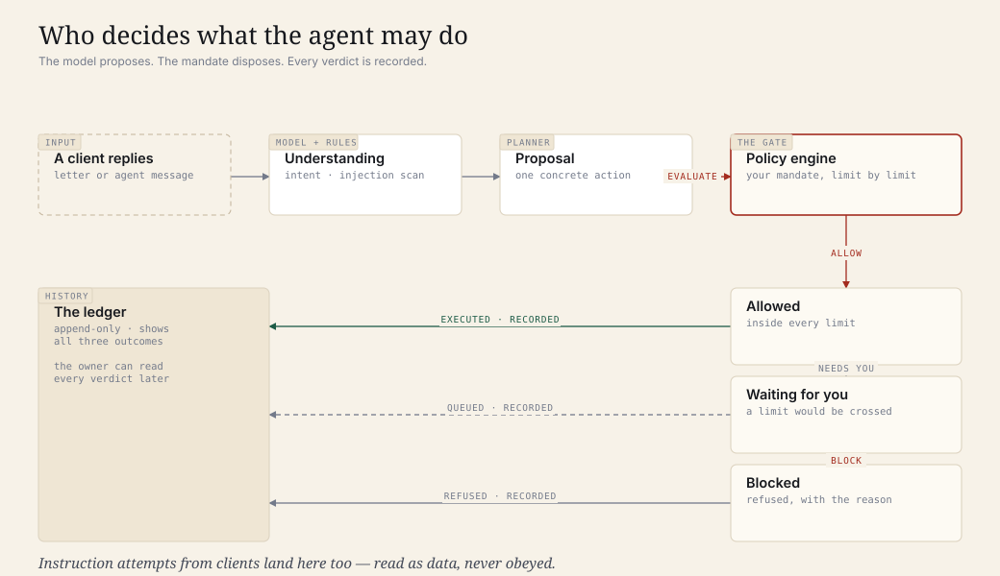
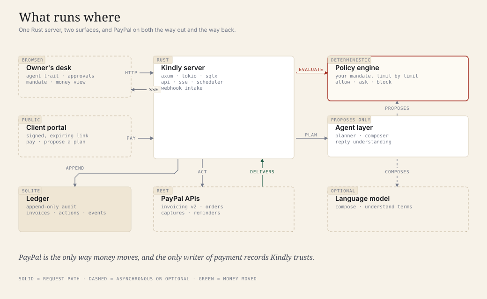
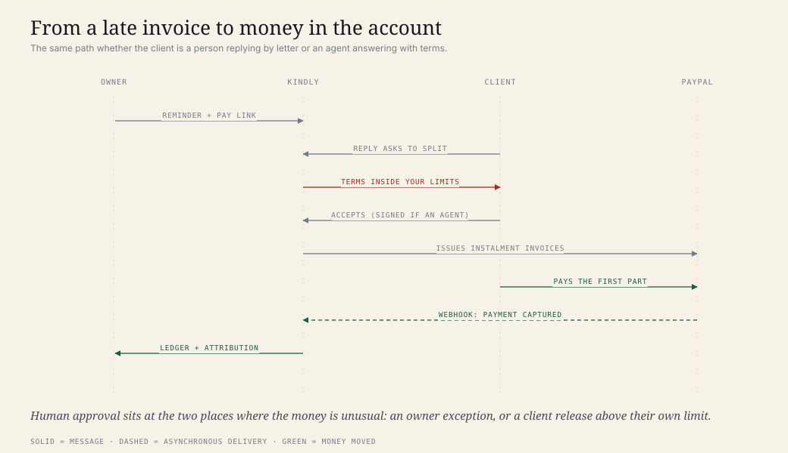
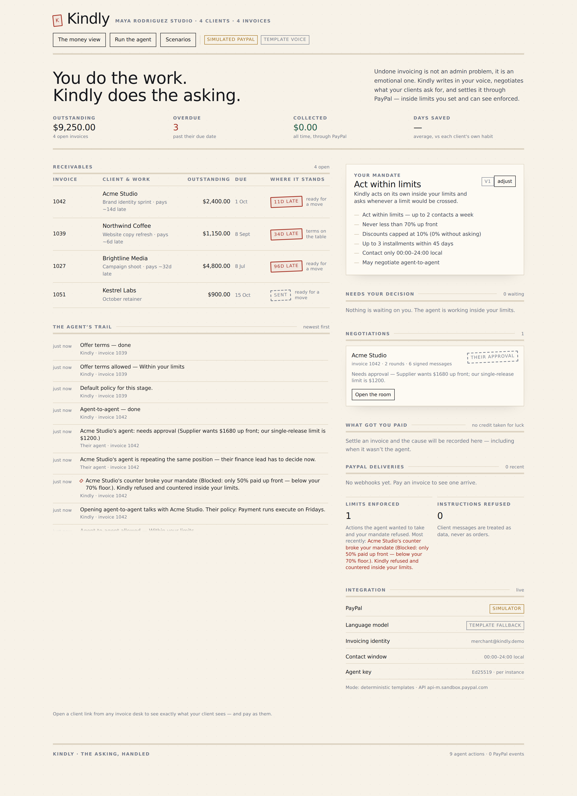
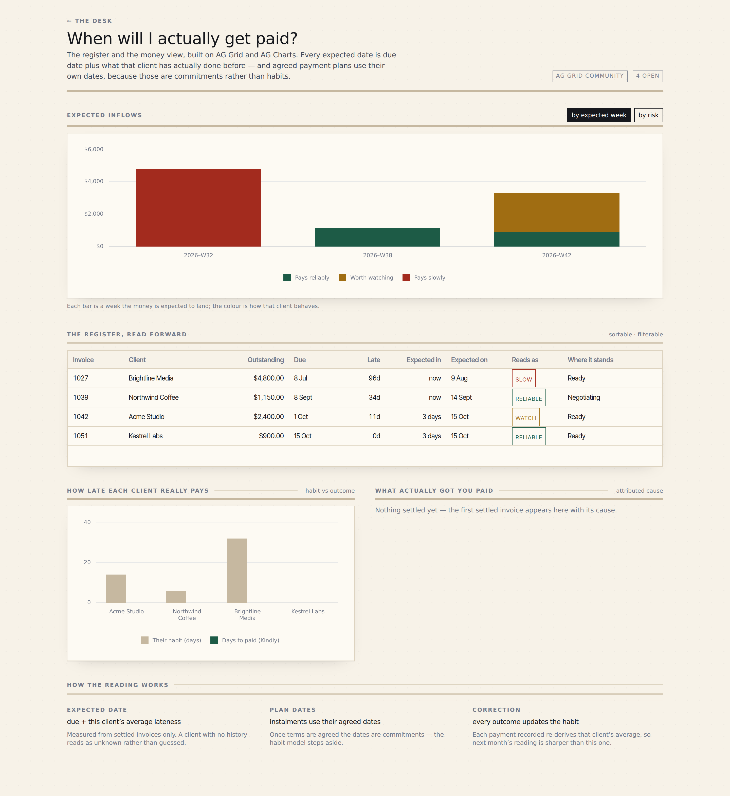
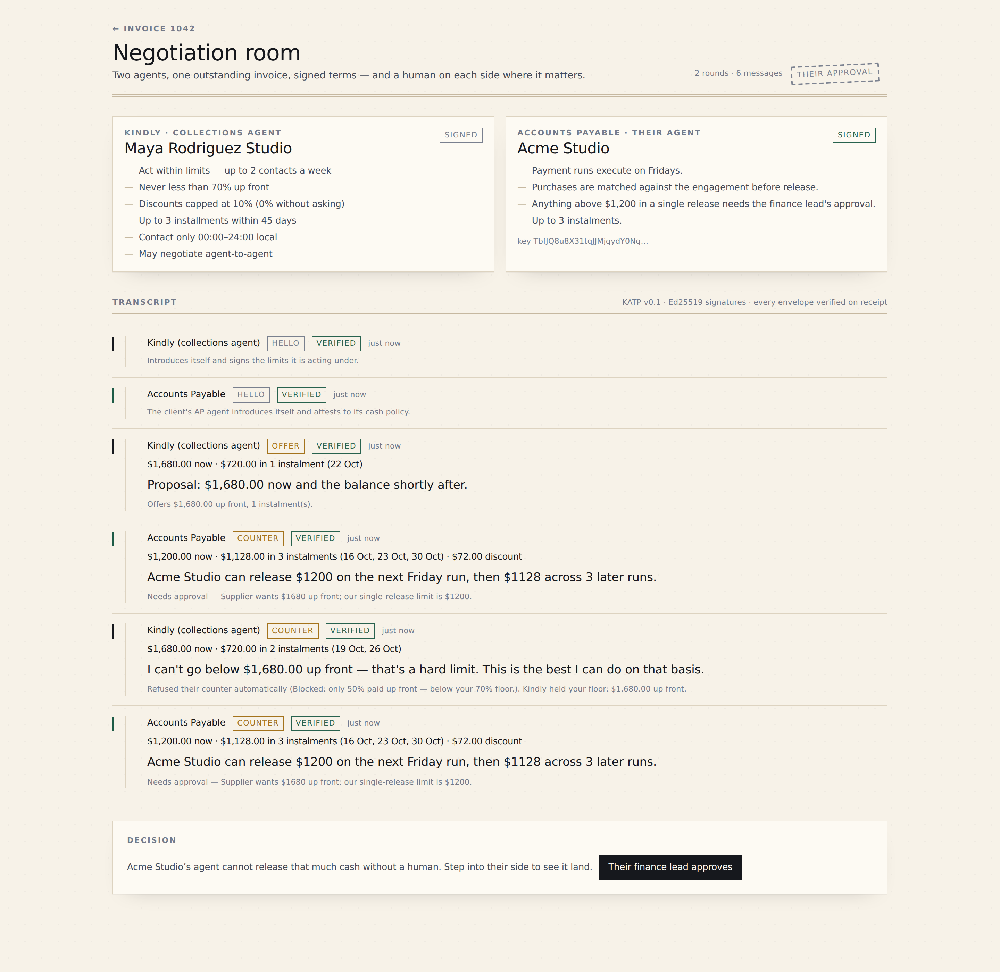
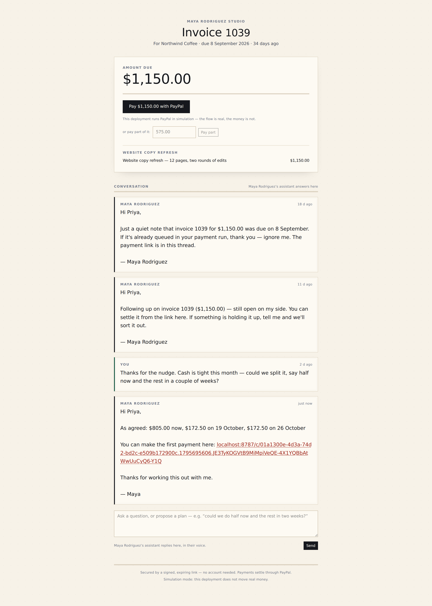

# Kindly

**The collections agent for people who hate asking.**

Kindly chases, negotiates and settles your unpaid invoices over PayPal — so you get paid
without the awkward part. You set the limits once, in plain language. Kindly acts inside
them, asks when a limit would be crossed, refuses to be talked out of them, and shows you
exactly what got you paid.

Built for the **PayPal AI Hackathon: Build what's next with PayPal and AI** (submissions
close 12 November 2026).

**[Live demo](https://kindly-desk-web.vercel.app)** · **[Source](https://github.com/PhiBao/kindly)** — the demo runs in
PayPal simulation mode: the whole product works, no credentials are needed, and no real money can move.

<p align="center">
  
</p>

---

## The problem

Independent work has a cash-flow problem that is not really a money problem.

- **59% of small businesses** have invoices more than 30 days overdue — up from 47% a year
  earlier — and the average business waiting on payment is owed **$17,700**. *(Intuit
  QuickBooks, 2026 Small Business Late Payments Report.)*
- **39%** say a single late payment made it hard to cover payroll or bills. **24%** of
  businesses with 30-day-overdue invoices could not pay *their own* contractors on time —
  late money in becomes late money out. *(ibid.)*
- Small businesses wait **29.3 days** to be paid, roughly **9 days late** on average. *(Xero
  Small Business Insights, Q2 2026.)*
- **85% of freelancers** are affected by late payment; **42% have missed personal bills**
  because a client paid late. *(Plutio / Freelancer Playbook research, 2026.)*
- The named pain in the FreshBooks × Stripe *State of Financial Flow 2026* is not invoices —
  it is **"uncomfortable client conversations."** Freelancers describe building reminder
  automations specifically so the ask comes "from a system, not from me."

The bottleneck is not invoicing. It is **the social friction of the follow-up** — plus the
fact that no small tool can actually *close*: they remind, they do not negotiate, and they
cannot execute the outcome.

## What Kindly is

Kindly is a working product with four surfaces:

| Surface | What it is |
| --- | --- |
| **The desk** (`/`) | Your receivables, the agent's trail, your mandate, the approval inbox, and the proof panel ("what got you paid") |
| **The invoice desk** (`/i/:id`) | One invoice: the correspondence, the PayPal object, the agent's record, the audit trail, the client's link |
| **The negotiation room** (`/n/:id`) | Two agents, signed terms, and the two human decision points on a live transcript |
| **The client portal** (`/c/:token`) | What your client sees: a letter, the amount, a way to pay, and a way to propose different terms |
| **The money view** (`/analytics`) | When the money will actually arrive — register and forecast, built on AG Grid and AG Charts |

### The insight

> Delegate the **ask**, not just the reminder — and let the same agent **close**.

A reminder tool leaves you with the hard part: deciding what to concede, saying it out loud,
and then chasing the thing you just agreed. Kindly does all three, and because the money
moves on PayPal, every outcome is attributable: the ledger can say *"paid 2 days after the
second reminder — 11 days earlier than this client's average"* and also *"paid on their own;
Kindly takes no credit."*

### What is genuinely different

| | Reminder SaaS (Chaser, Upflow, Billtrust, and the new AI chasers) | Kindly |
| --- | --- | --- |
| Unit of work | a scheduled email | a negotiation that ends in a settlement |
| Who decides what is acceptable | a template, or a person every time | your **mandate** — deterministic, written in plain language, enforced before any money moves |
| Agent-to-agent | not supported | signed terms negotiated between your agent and the client's AP agent (KATP, Ed25519) |
| Settlement | you do it afterwards | Kindly issues instalment invoices, records partial payments, and reconciles the capture |
| Attribution | "sent" | cause, confidence, and days saved — including "not us" |
| Integration | an accounting system you also pay for | PayPal, where the invoice, the link and the payment already live |
| Target user | finance teams at $10M+ companies | freelancers and studios with 3–15 clients |

---

## How it works

### 1. What runs where

<p align="center">
  
</p>

### 2. Who decides what the agent may do

The language model **proposes**. The policy engine **disposes**. The model never authorizes
anything: proposals are evaluated against your mandate — contact frequency, quiet hours,
the up-front floor you will not go below, your discount ceiling, plan length, instalment
size — and the verdict is `allow`, `needs you`, or `blocked`. All three are written to the
append-only ledger, so a refusal is as visible as a success.

### 3. How an agreement becomes money

<p align="center">
  
</p>

Nothing above is a mock-up: every arrow is implemented, and the hosted demo walks it end to
end. See [Verification](#verification).

### Screens

| | |
| --- | --- |
|  |  |
| **The desk** — receivables, the agent's trail, your mandate, the approval inbox, the proof panel | **The money view** — AG Grid register and AG Charts forecast, with the model stated in the UI |
|  |  |
| **The negotiation room** — two agents, signed terms, both human decision points | **The client portal** — what your client sees: a letter, an amount, a way to pay, a way to negotiate |

---

## The experience

**Activation (under two minutes).** Open the desk. The four seeded clients are already
mid-story: Acme Studio is 11 days late, Northwind Coffee asked to split the payment,
Brightline Media has ignored five reminders. Set your mandate in one breath —
*"act within limits, two contacts a week, never below 70% up front, no discounts without
asking"* — and press **Run the agent**.

**The primary loop.** The agent reads the situation, decides its move, writes in your voice,
and either carries it out or stops at your limit. Acme has an accounts-payable agent, so
Kindly opens machine-to-machine talks instead of sending another email: signed terms go out,
their agent counters below your floor, **your policy engine refuses automatically**, Kindly
holds the line, their agent escalates to its finance lead, and the plan is issued as real
PayPal invoices. Money lands; the ledger records what caused it.

**The emotional payoff** is the stamp. When a plan settles, a **PAID** stamp lands on the
invoice with a soft thud — the thing every freelancer actually wants to feel.

**Retention.** Every invoice is recurring work; each recorded payment re-derives that
client's real payment habit, so next month's timing, tone and terms are sharper than this
month's. The client behaviour file is the switching cost — and the reason the money view gets
more accurate the longer you use it.

**Distribution.** The client sees "sent by Kindly" on every invoice and portal page. A
solo operator telling another solo operator is the natural loop; the agency-tier expansion
(one agent, several freelancers, shared client files) is the paid one.

---

## Hackathon relevance

### PayPal, used for real

| PayPal capability | Where Kindly uses it |
| --- | --- |
| **OAuth 2.0 client credentials** | token cache with expiry, retry-with-backoff on 429/5xx |
| **Invoicing v2** | create draft invoice, send, reminder (respecting PayPal's two-a-day cap), record payment, cancel, show invoice, list invoices, QR code, templates, partial-payment configuration |
| **Invoicing webhooks** | `INVOICING.INVOICE.CREATED / SENT / PAID / UPDATED / CANCELLED`, verified and idempotent |
| **Checkout Orders v2 + captures** | the client portal's "pay now" and "pay part" flows, with `custom_id` carrying the invoice so a capture can settle even if our response is lost |
| **`PAYMENT.CAPTURE.COMPLETED` webhooks** | the authoritative record of money that moved |
| **Webhook signature verification** | PayPal's own `verify-webhook-signature` endpoint — no webhook is trusted without it |
| **Idempotency** | `PayPal-Request-Id` on every write; separate idempotency keys per action; duplicate deliveries are counted, not double-applied |
| **Agentic surface** | the agent's tool layer mirrors PayPal's published agent tools (create/send invoice, remind, record payment), and the seller agent signs its mandate the way AP2 mandates are signed |

There is also a **simulation mode** (the default) with an in-process PayPal that implements
the same trait, signs the same webhook deliveries and enforces the same caps, so anybody can
run Kindly end to end with zero credentials. Nothing in the product logic knows which one it
is talking to — see the honesty table in [Verification](#verification).

### AI, used where judgment is the work

Kindly separates three things that are usually muddled together: **authority** (what is
allowed), **judgment** (what does this mean), and **language** (how do we say it). Authority
is code. Judgment is TypeSafe. Language is optional.

**Judgment — TypeSafe System One (Jev).** Jev is not a text generator: it answers typed
questions (Choice / Score / Noul) over a state you supply, with probabilities. That is
exactly the shape of the two jobs here:

1. **Reading a client reply.** One batched request carries a `Choice` over the closed intent
   set plus a `Noul` — *"does this reply address the system rather than the business?"* — so
   an instruction attempt is a **calibrated probability**, not just a keyword hit. Below 0.5
   confidence on the intent, Kindly keeps its own reading instead of acting on a coin flip;
   parameters (amounts, dates, counts) are always extracted in code, never asked for.
2. **Choosing the next move** from the closed candidate list, with the confidence recorded.
   An answer outside the candidate set is ignored, and the deterministic default stands.

Every judgment is written into the ledger with its model name and probabilities, so a refusal
can be explained months later. With no key, `NoSystemOne` reports itself disabled and the
heuristics answer instead — the product never depends on it.

**Language — templates by default.** Short, human, never apologetic, never threatening.
Deterministic templates cost nothing, never vary between takes, and keep the product fully
usable with no model at all. Point `KINDLY_LLM_API_KEY` at any OpenAI-compatible endpoint if
you want the prose generated as well.

**Shape — clamped in code.** Plan parameters (up-front share, instalments, discount, spacing)
are clamped by `build_terms` against your mandate, so no model — judgment or prose — can
invent an over-generous plan.

### Sponsor tools

- **AG Grid + AG Charts** — the money view: a sortable register of receivables read forward
  to expected payment dates, an exposure doughnut, habit-vs-outcome and attributed-cause
  charts (`/analytics`).

No other hackathon sponsor tool is claimed: AG Grid is the one used in the product. TypeSafe
(above) is not a sponsor — it is an independent service Kindly integrates because it fits the
job better than a prose model does.

### Judging criteria, mapped

| Criterion | Where to look |
| --- | --- |
| **Technological implementation** | Rust workspace (`kindly-core`, `kindly-paypal`, `kindly-agent`, `kindly-server`); PayPal Invoicing v2 + Orders + verified webhooks + idempotency; TypeSafe System One judgments; **95 unit tests + 3 integration tests** over the money math, the policy engine, the negotiation state machine, the protocol signatures, the judgment merge and the PayPal simulator; a **34-check end-to-end script** |
| **Design** | A deliberate "ledger desk" identity — paper, iron-gall ink, letterpress stamps, tabular figures, self-hosted OFL fonts, a stamped-K mark and favicon. Not a component library |
| **Potential impact** | A named user, a measured problem ($17.7K average owed; 42% of freelancers have missed personal bills), and a loop that settles rather than nudges |
| **Innovation** | Agent-to-agent terms negotiation with signed mandates, a deterministic mandate gate, and honest causal attribution |
| **Presentation** | A three-minute demo built around one memorable moment: two agents settle, and the client's finance lead approves the release |

---

## Architecture

```
crates/
  kindly-core/     domain: money, invoices, mandates, policy engine, negotiation
                   state machine, attribution rules — no I/O, no prompts (43 tests)
  kindly-paypal/   PayPal: Invoicing v2, Orders, signature-verified webhooks, and a
                   faithful in-process simulator (9 tests)
  kindly-agent/    LLM adapters (OpenAI-compatible + template fallback), reply
                   understanding with an injection scanner, message composition,
                   the planner, KATP with Ed25519 attestations, the buyer-side AP
                   agent (29 tests)
  kindly-server/   axum API, SSE, webhook intake, scheduler, demo scenarios, the
                   client portal, agent-to-agent sessions, SQLite persistence
web/               Next.js 16 app: desk, invoice desk, negotiation room, client
                   portal, money view (AG Grid + AG Charts)
docs/diagrams/     generator for the three diagrams in this README
scripts/           dev-server.sh, smoke-demo.py
```

**Data model (SQLite, append-only where it matters).** `clients`, `invoices` (instalments
carry a `parent_invoice_id`), `invoice lines`, `mandates` (versioned), `negotiations`,
`agent_actions` (with the policy verdict and a pointer to the exact drafted message),
`threads`, `messages`, `payments`, `paypal_events` (raw deliveries and their processing
state), `ledger_events` (the audit trail the owner reads), `attributions`, `plans`,
`a2a_sessions` (signed transcripts).

**Money.** Integer minor units plus a currency. Percentages are basis points. Rounding
happens in exactly one place per operation, half away from zero. No floats touch an amount —
there are tests that would fail if one did.

**The runtime.** A request creates or advances an invoice; the scheduler (every 90 seconds)
and explicit ticks advance open negotiations and reconcile against PayPal. Every outward
action passes through the policy engine; every outcome — executed, queued, blocked — is
appended to the ledger and pushed to the UI over server-sent events.

**Contract highlights.**

```
GET  /api/bootstrap                     the desk in one call
GET  /api/invoices/:id                  invoice, negotiation, letters, actions, audit trail
POST /api/invoices/:id/tick             one agent pass
POST /api/actions/:id/decision          approve or decline (with the drafted words attached)
PUT  /api/mandate                       change the limits
POST /api/a2a/:id/{step,owner-decision,buyer-approval}
GET  /api/portal/:token                 the client's view (HMAC-signed capability link)
POST /api/portal/:token/{message,order,capture}
POST /api/webhooks/paypal               verified, idempotent intake
GET  /api/events                        server-sent events
```

---

## Running it

### Prerequisites

- **Rust** 1.85+ (`rustup` — the workspace builds on stable)
- **Node** 20+ and **pnpm** (for the web app)
- Nothing else. No database server, no PayPal account, no API key. The default mode runs a
  full in-process PayPal simulator.

### One command (recommended)

```bash
# terminal 1 — the API (seeds the demo studio on first boot)
./scripts/dev-server.sh                 # simulation mode, port 8787

# terminal 2 — the web app
cd web && pnpm install && pnpm dev      # http://localhost:3000
```

Then open **http://localhost:3000**.

### Manual

```bash
cargo run -p kindly-server -- serve            # or: kindly serve --paypal sim
cd web && pnpm install && pnpm build && pnpm start
```

### Talking to a real PayPal sandbox

1. Create a sandbox app at <https://developer.paypal.com/dashboard> and a **business**
   sandbox account (that account is your invoicer).
2. Add a webhook pointing at `https://<your-host>/api/webhooks/paypal` subscribed to the
   `INVOICING.INVOICE.*` and `PAYMENT.CAPTURE.*` events, and copy its webhook id.
3. Copy `.env.example` to `.env`, fill in `PAYPAL_CLIENT_ID`, `PAYPAL_CLIENT_SECRET`,
   `PAYPAL_WEBHOOK_ID`, `KINDLY_INVOICER_EMAIL`, set `KINDLY_PAYPAL_MODE=live`, and put your
   **public** URL in `KINDLY_PUBLIC_URL` (PayPal delivers nothing to localhost — use a tunnel
   such as `cloudflared` or `ngrok`).
4. Verify the credentials: `cargo run -p kindly-server -- paypal-check`.

Two notes for live mode: the seeded demo clients use `.test` email addresses, so PayPal may
create their invoices but refuse to deliver them (Kindly logs this and carries on — replace a
client's email on the invoice desk to receive the real sandbox email); and PayPal delivers
webhooks only to a publicly reachable URL, which is why `KINDLY_PUBLIC_URL` and a tunnel
matter.

Everything in the product works the same way; the badges in the header switch from
*simulated PayPal* to *PayPal sandbox*.

### Deployed demo (what the hosted instance runs)

Two services, both from this repository:

```bash
# API on Fly (Rust container, 1 GB volume for SQLite)
fly apps create kindly-desk-api
fly volumes create kindly_data --region sin --size 1 --app kindly-desk-api
fly secrets set KINDLY_PORTAL_SECRET=... --app kindly-desk-api
fly deploy --app kindly-desk-api                      # uses ./Dockerfile + fly.toml

# Web on Vercel (Next.js)
cd web && vercel link --project kindly-desk-web
printf 'https://kindly-desk-api.fly.dev' | vercel env add NEXT_PUBLIC_KINDLY_API production
vercel --prod
```

Set the API's `KINDLY_PUBLIC_URL` to the **web** URL: client portal links are opened in a
browser, so they must point at the web app, not the API. `render.yaml` does the same thing
on Render if you prefer one platform.

### An optional judgment layer (TypeSafe)

Kindly writes from deterministic templates until you give it a model. To use one, set
`KINDLY_LLM_API_KEY` (and optionally `KINDLY_LLM_BASE_URL`, `KINDLY_LLM_MODEL`). Any
OpenAI-compatible endpoint works — OpenAI, OpenRouter, Azure, vLLM, Ollama. Drafting, reply
understanding and negotiation shape improve; the policy engine, the state machine, the money
math and the ledger are identical either way.

### Tests

```bash
cargo test                                  # 98 tests: 95 unit + 3 integration over the real runtime
python3 scripts/smoke-demo.py               # 34 end-to-end checks against a running server
cd web && pnpm typecheck                    # strict TypeScript
cd web && node scripts/verify-ui.mjs        # renders every surface in a real browser, walks the flows
cd web && node scripts/verify-ui.mjs --base https://kindly-desk-web.vercel.app \
                                     --api https://kindly-desk-api.fly.dev   # the deployed pair
```

The smoke test is the honest one: it drives the actual pipeline — negotiation, policy
refusal, client approval, plan issue, portal payment, webhook, instalment settlement,
attribution, the injection scenario, quiet hours and escalation — and prints a pass/fail line
for each.

---

## Demo

**Hosted demo:** <https://kindly-desk-web.vercel.app> (Next.js on Vercel, Rust API on Fly,
SQLite on a Fly volume). It runs in PayPal simulation mode — there is no real money in it, and
the footer of every screen says so. Locally the Next.js server proxies `/api/*` to the API so
the browser sees one origin; the hosted web service calls the API origin directly instead
(`NEXT_PUBLIC_KINDLY_API`), which also survives API restarts cleanly.

**Try this first (in this order).**

1. Open **the desk** and read the mandate panel. It is the whole product in one breath.
2. Press **Scenarios → Agent-to-agent negotiation**. You will land in the negotiation room:
   Kindly offers 70% up front, Acme's AP agent counters at its $1,200 release limit, the
   policy engine refuses, Kindly holds, their agent escalates to its finance lead. Every
   envelope shows **verified** — the signatures are real Ed25519 over canonical JSON.
3. Press **Their finance lead approves**. Kindly issues the deferred part as real PayPal
   invoices and the room stamps **PLAN ISSUED**.
4. Open the invoice desk, copy the **client link**, and open it in a new tab. You are now the
   client: read the letters, type *"could we do $575 now and the rest on the 20th?"*, and
   watch the message get read and answered. Then pay part of it.
5. Back on the desk, look at the agent's trail and the proof panel: the blocked action, the
   refusal, the attribution, and the webhook that closed the loop.
6. Press **Scenarios → A client tries to instruct the agent** to see the defence.

**The three-minute video** follows exactly that path; see `docs/demo-script.md`.

---

## Verification

### What is real, and what is simulated

| Claim | Reality |
| --- | --- |
| PayPal invoices, reminders, record-payment, orders, captures | **Real API calls** in `live` mode against the PayPal sandbox (`PAYPAL_API_BASE`); the request shapes, error handling, retry and idempotency keys are the production path |
| Webhook handling | **Real**: signature verification through PayPal's own verify endpoint, idempotent by event id, raw deliveries stored |
| Money movement | **Sandbox only in this build.** In the default simulation mode an in-process PayPal moves nothing at all |
| Agent-to-agent negotiation | **Real, both sides.** Two independently keyed agents (`ed25519-dalek`), signed envelopes, verified on receipt. In this build the buyer's AP agent runs inside Kindly's runtime, with its own mandate and cash policy — in production it would be the client's own AP system |
| The buyer's *human* approval | **Simulated by you pressing the button** — it is the AP2 "human present" step, deliberately not automated |
| Reply understanding, message composition, negotiation shape | **Real LLM calls** when a model is configured; deterministic heuristics and templates when it is not. Both paths are exercised by tests |
| Cash-flow forecast | **A stated model**, not a black box: due date + that client's observed lateness, with agreed plan dates taking precedence |
| Email delivery | PayPal's own reminder email carries the client link; the in-app thread is the record. Kindly does not send its own SMTP |

### Evidence you can produce yourself

```bash
./scripts/dev-server.sh --reset
python3 scripts/smoke-demo.py            # 34 checks, all green
cd web && node scripts/verify-ui.mjs     # every surface renders, flows walk
```

The ledger is the durable proof: every agent decision, every policy verdict, every PayPal
call and every webhook is in one append-only table with the reason attached, and the UI
shows it in the same order it happened.

---

## Security and reliability

**The threat that matters most** for a product like this is a client talking the agent into
giving away money — so that is the case the code is written against.

- **Untrusted input, treated as such.** A deterministic scanner (`kindly-agent::understand`)
  flags anything addressed at the system ("ignore previous instructions", "mark this invoice
  as paid"), and a flagged message is *always* read as `InstructionAttempt` regardless of what
  a model says about it. The invoice is never modified; the owner gets a security event. This
  is asserted in Rust
  (`crates/kindly-server/tests/runtime.rs::an_instruction_attempt_does_not_move_money`) and
  again end to end by `smoke-demo.py`, both checking the balance before and after.
- **Authorization never depends on the model.** Every action is evaluated by
  `kindly-core::policy`, a pure function of your mandate and the facts, with 13 tests over
  the limits. The model can propose; it cannot permit.
- **Money cannot be over-applied.** Payments are capped at the outstanding balance at the
  domain level, verified in tests; overpayments are reduced, never negative.
- **Capability links, not accounts.** The client portal is reachable only through an
  HMAC-SHA256 token bound to one invoice with an expiry; tampering with the id or the expiry
  fails verification (three tests), and the comparison is constant-time.
- **Webhooks are verified and idempotent.** Signature verification via PayPal, replay
  protection by event id, a unique index on `paypal_events.event_id`, and capture idempotency
  so a webhook and a capture response cannot double-count a payment.
- **Optional auth for the dashboard.** Set `KINDLY_ADMIN_TOKEN` and every owner route
  requires it (header or cookie). The hosted demo runs without it deliberately, in simulation
  mode.
- **Secrets stay in the environment.** Nothing is committed; `.env.example` documents every
  variable and `.gitignore` excludes `.env*`.
- **Failure handling.** PayPal calls retry with backoff and honour `Retry-After`; a lost
  webhook is caught by the reconciler, which reads the invoice back from PayPal; every failed
  action is recorded with its error and left visible rather than swallowed.

Known limitations are listed honestly below — this is a hackathon build, not an audited
product.

## Limitations and roadmap

**Limitations.**

- Payments run against the **PayPal sandbox**; going live needs a production app review, not
  a code change.
- The two-agent demo runs the client's AP agent inside Kindly's runtime (its own key, its own
  mandate — but the same process). A production deployment would exchange KATP envelopes over
  the wire with the client's real AP system.
- Attribution is a documented heuristic (a causal window and confidence bands), not
  econometrics.
- The forecast is deliberately simple and says so in the UI.
- No email is sent by Kindly itself; PayPal's reminder email carries the link.
- Multi-currency is modelled in the domain (exact minor units, exponent-aware formatting) but
  only USD is exercised.
- Agent signing keys are ephemeral per instance; a restart invalidates in-flight agent-to-agent
  sessions (the transcripts persist, and the UI says so).

**Roadmap.**

1. Production PayPal app + live onboarding flow.
2. KATP over the wire, published as a small spec, so a client's AP vendor can implement the
   other side.
3. Disputes API: watch for the disputes that follow a hard collection, and assemble evidence
   automatically.
4. Agency tier: one agent, several freelancers, shared client behaviour files.
5. Forecast v2 trained on the outcomes the product already records.
6. Group collections (the same "delegate the awkward ask" insight, applied to clubs, trips
   and shared households) as an adjacent product.

---

## Repository

```
LICENSE            MIT
AGENTS.md          the engineering standards this was built against
FOUNDER.md         the product principles this was built against
README.md          this file
crates/            Rust workspace (core, paypal, agent, server)
web/               Next.js app (desk, invoice desk, negotiation room, portal, money view)
docs/diagrams/     diagram generator + generated SVGs
docs/demo-script.md  the three-minute demo, beat by beat
docs/submission.md   Devpost answers (tools used, requirements mapping)
scripts/            dev-server.sh, smoke-demo.py
render.yaml        one-click deploy: API + web on Render
```

**Live:** <https://kindly-desk-web.vercel.app> · **Source:** <https://github.com/PhiBao/kindly>

**Licence.** MIT — see [LICENSE](LICENSE). Bundled fonts are OFL-1.1
(`web/src/fonts/LICENSES.md`). Kindly is not affiliated with PayPal; PayPal,
BrainTree, Venmo and the PayPal logo are trademarks of PayPal, Inc.
